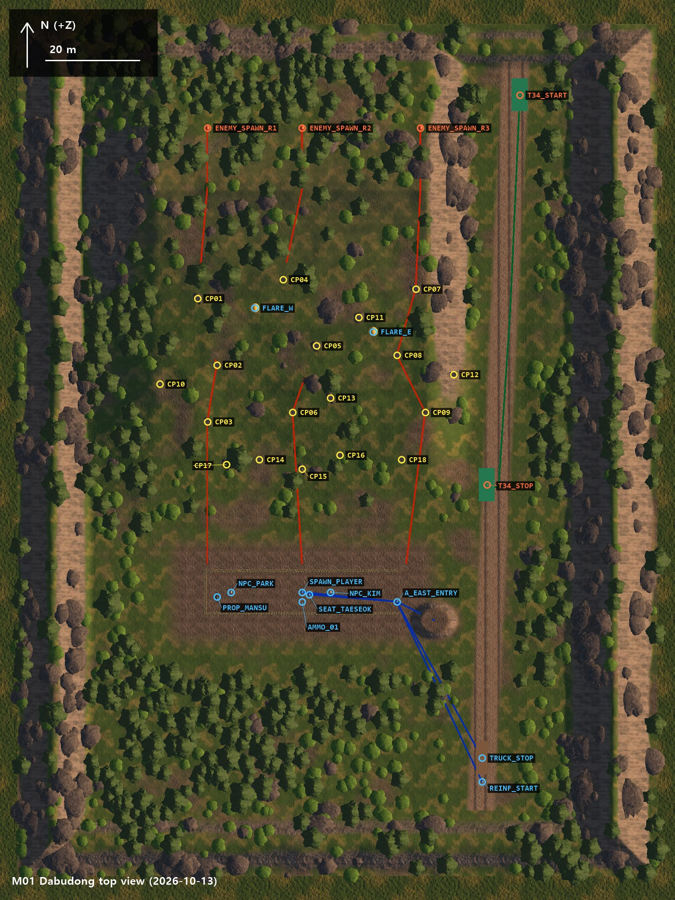

# M01 다부동 탑뷰

「다섯 개의 강」 M1 시연 구간(B안, 관람형, 약 3분)의 레벨을 위에서 본 그림과 마커 위치다. 레벨 탑뷰 논의에 쓴다. (정리: 2026-10-12, 흐름표 초안 삭제: 2026-10-13)

## 탑뷰

- 위쪽이 북(+Z). 그림 세로가 190 m, 가로가 142.5 m다.
- 지형 범위는 x −60~75, z −60~120. 기준점 (0, 0)은 플레이어 시작 자리다.
- 빨강: 적 등장 지점·T-34, 빨간 선은 진입로 1~3
- 노랑: 엄폐 지점 CP01~CP18
- 파랑: 아군 자리·조명탄, 파란 선은 아군 이동 경로
- 그림을 다시 뽑으려면 유니티에서 M01_Dabudong 씬을 열고 메뉴 `FiveRiver > M1 탑뷰 캡처`를 누른다. `Shots/TopView/`에 저장된다(마커 이름은 따로 그려 넣은 것).

## 마커 위치

좌표 단위는 미터. x는 동쪽이 +, z는 북쪽이 +, y는 높이.

| 마커 | x | z | y | 메모 |
|---|---:|---:|---:|---|
| SPAWN_PLAYER | 0 | 0 | 0.9 | 오석구 시작 자리. 북쪽을 바라본다 |
| SEAT_TAESEOK | 1.5 | −0.5 | 0.3 | 새벽에 태석이 앉는 자리 |
| NPC_KIM | 6 | 0 | 0.9 | 김덕만 |
| NPC_PARK | −15 | 0 | 0.9 | 박용팔 |
| AMMO_01 | 0 | −2 | 0.25 | 탄약 상자 |
| PROP_MANSU | −18 | −1 | 0.15 | 담요를 덮은 형체 |
| A_EAST_ENTRY | 20 | −2 | 0.3 | 도입·새벽 경로 입구 |
| TRUCK_STOP | 38 | −35 | 1.25 | 트럭 하차 0:00 |
| REINF_START | 38 | −40 | 0.3 | 보충병 등장 2:25 |
| FLARE_W | −10 | 60 | 120 | 조명탄 서쪽 (높이 120 m) |
| FLARE_E | 15 | 55 | 120 | 조명탄 동쪽 (높이 120 m) |
| ENEMY_SPAWN_R1 | −20 | 98 | 9.3 | 진입로 1 스폰 |
| ENEMY_SPAWN_R2 | 0 | 98 | 9.3 | 진입로 2 스폰 |
| ENEMY_SPAWN_R3 | 25 | 98 | 9.3 | 진입로 3 스폰 |
| T34_START | 46 | 105 | 1.35 | T-34 등장 1:45 |
| T34_STOP | 39 | 22.7 | 1.35 | 정지 2:10, 진지 중심에서 약 45 m. 도로 위에서 진지 쪽으로 차체를 돌려 선다 |
| CP01 | −22 | 62 | 10.29 | 진입로 1 |
| CP02 | −18 | 48 | 7.08 | 진입로 1 |
| CP03 | −20 | 36 | 4.41 | 진입로 1 |
| CP04 | −4 | 66 | 10.85 | 진입로 2 |
| CP05 | 3 | 52 | 8.10 | 진입로 2 |
| CP06 | −2 | 38 | 4.73 | 진입로 2 |
| CP07 | 24 | 64 | 9.70 | 진입로 3 |
| CP08 | 20 | 50 | 7.16 | 진입로 3 |
| CP09 | 26 | 38 | 4.65 | 진입로 3 |
| CP10 | −30 | 44 | 6.13 | 서쪽 측면 |
| CP11 | 12 | 58 | 9.02 | 2와 3 사이 |
| CP12 | 32 | 46 | 2.84 | 동쪽 측면 |
| CP13 | 6 | 41 | | 진입로 2 가까이 (2026-10-13 추가) |
| CP14 | −9 | 28 | | 진입로 2 아래 (추가) |
| CP15 | 0 | 26 | | 진입로 2 아래 (추가) |
| CP16 | 8 | 29 | | 진입로 2 아래 (추가) |
| CP17 | −16 | 27 | | 진입로 1 아래 (추가) |
| CP18 | 21 | 28 | | 진입로 3 아래 (추가) |

## 흐름표·동선·수치

흐름표, 시연자 동선, 수치는 [B안_기획서.md](B안_기획서.md) 3~4장을 그대로 쓴다. 이 문서에 있던 흐름표 초안과 인물 동선 초안은 기획서를 읽기 전에 만든 것이라 2026-10-13에 지웠다.

게임에 들어간 값은 `Assets/_Project/Resources/M01_DemoData.asset`에 있고 Inspector에서 고친다.

## 레벨에서 고친 곳 (2026-10-13)

시연자 동선을 자동으로 따라 해 보고 기획서대로 되지 않던 곳을 고쳤다. 위 탑뷰 그림은 고친 뒤에 다시 뽑은 것이다.

| 문제 | 고친 내용 | 다시 확인한 결과 |
|---|---|---|
| 1:55에 진지 가운데에서 T-34가 경사면에 가려 안 보였다 | 전차가 1:55까지는 빠르게(초속 약 7 m), 그 뒤로는 2:10까지 천천히 내려온다 | 1:55에 진지 가운데에서 쏜 정면 1발이 맞고 튕긴다(차체 앞에서 49도) |
| 둔덕(D)이 정지한 전차의 옆이 아니라 앞쪽 오른편이었다 | T34_STOP을 도로 위 (39, 22.7)로 옮기고, 전차가 마지막에 서쪽으로 돌아 진지를 마주 보고 선다. 측면 판정은 "차체 앞에서 60도 넘게 벗어난 자리"다 | 둔덕에서는 옆구리(82도)가 보인다. 측면 2발에 2:15 정지 |
| 적이 40~55 m에 멈춰 작게 보였다 | 진지에서 20~40 m에 엄폐 지점 CP13~CP18을 더하고 공세의 적이 그 옆에 멈춘다. 뛰는 속도는 초속 6.5 m | 0:52 화면에서 엄폐물 옆의 적이 뚜렷하게 보인다 |

사격 발판은 넣었다가 뺐다. 기획서에 없는 구조물이고, 엎드리기는 흙벽 밑에 숨는 동작이라 흙벽 너머가 안 보이는 것이 맞다. 시연자는 0:25에 엎드렸다가 일어나서 쏜다.

아직 남은 것:

- 1:45~1:54에는 전차가 경사면 뒤라 진지에서 보이지 않는다(1:54쯤부터 보인다). 진지에서 도로 북쪽 끝을 보는 시선이 경사면 동쪽 절반을 통째로 지나가서, 자락을 조금 깎는 정도로는 해결되지 않는다. 기획서의 "도로 끝 전차 실루엣"을 살리려면 지형을 다시 잡거나, 등장 연출을 "소리와 조명탄 먼저, 실루엣은 1:54"로 바꾸는 결정이 필요하다.
- CP13~CP18의 엄폐물은 기존 모래주머니·바위 소품을 복사해 둔 것이다.
