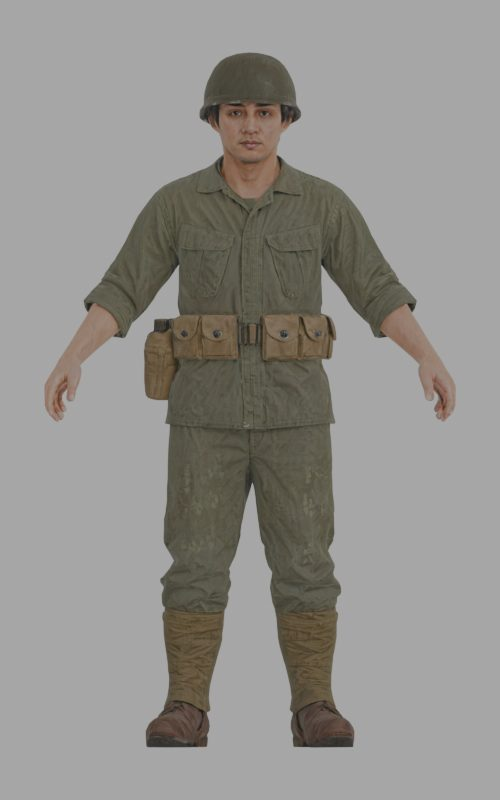
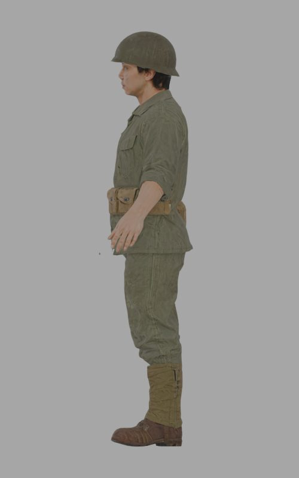
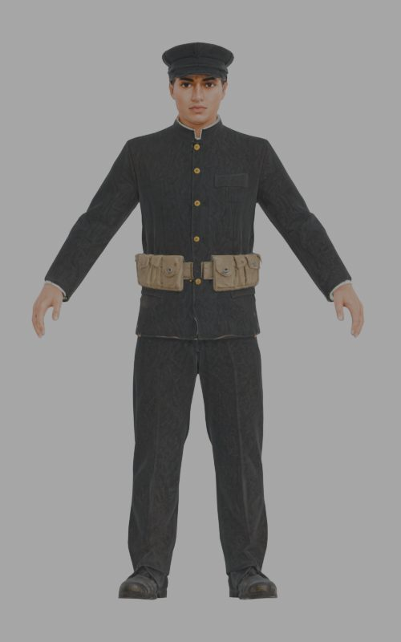
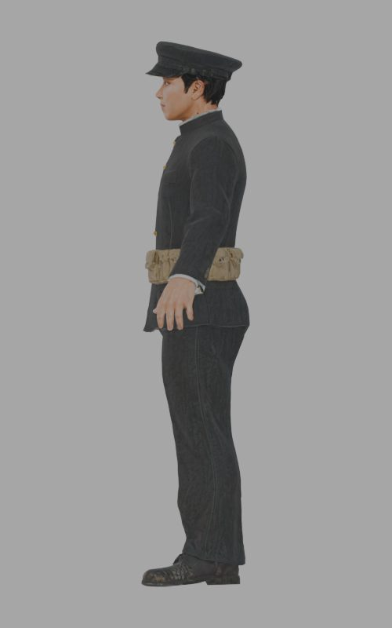
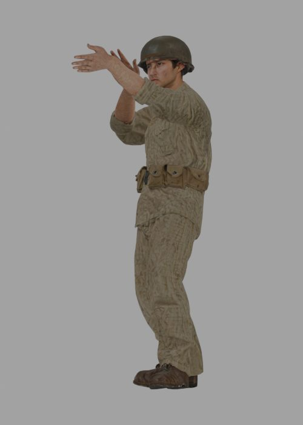
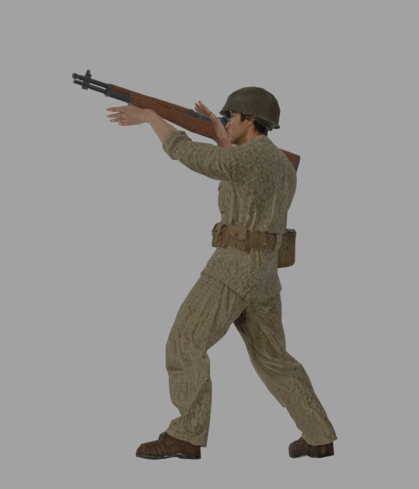
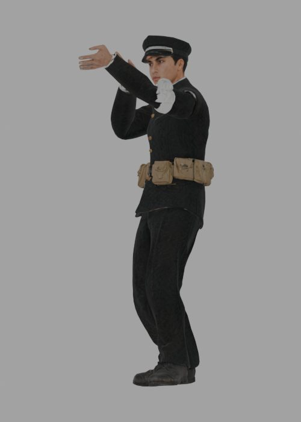
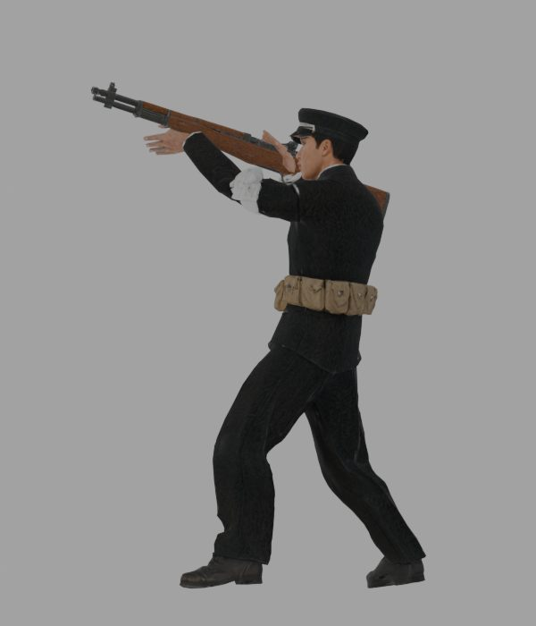

# 바르코3D 원본 → 블렌더 정리 전후 비교 (오석구·윤태석)

작성: 2026-10-15. 「다섯 개의 강」 M1 다부동 시연용 인물 2명.
수치는 블렌더 5.2에서 스크립트로 뽑았다(`ArtSource/Preview/Compare/measure.json`, `anim.json`, `rifle.json`).

## 1. 과정 한눈에

1. 바르코3D 워크플로 '다섯개의강'에서 텍스트 → 이미지 → 복장 고증 수정 → 3D 생성(2만 삼각형, 2K PBR).
2. 바르코3D `Rig`(Humanoid)로 뼈대를 넣고, `Animate`에서 **장총 사격** 동작을 입혔다.
3. 블렌더에서 키·원점·면 수를 정리하고, M1 개런드 소총(이것도 바르코3D 생성물)을 오른손 뼈에 붙였다.
4. 유니티용 FBX로 내보냈다(`ArtSource/Export/<이름>_RifleShot.fbx`).

## 2. 정리 전후 그림

| | 정리 전 (바르코3D 원본) | 정리 후 (블렌더) |
|---|---|---|
| 오석구 정면 |  |  |
| 오석구 측면 |  |  |
| 윤태석 정면 |  |  |
| 윤태석 측면 |  |  |

| | 바르코3D 애니메이션 (총 없음) | 블렌더 정리 후 (M1 소총 부착) |
|---|---|---|
| 오석구 |  |  |
| 윤태석 |  |  |

## 3. 수치 비교

| 항목 | 정리 전 (바르코3D 원본) | 정리 후 (블렌더) |
|---|---|---|
| 삼각형 수 | 20,000 | 8,000 (Decimate, 뼈 가중치 유지) |
| 크기 | 키 1.0 m (단위 없이 1로 맞춰져 나옴) | 오석구 1.70 m, 윤태석 1.66 m |
| 원점 | 몸 한가운데 (높이 -0.5 ~ +0.5) | 두 발 사이 바닥 |
| 축 | glTF/FBX 기본 (Y 위) | 유니티 기준으로 내보냄 (Y 위, -Z 앞) |
| 텍스처 | BaseColor·Normal·ORM 2K 각 1장 | 그대로 사용 (다시 굽지 않음, UV 원본 유지) |
| 뼈대 | 바르코3D Humanoid 23개 (Root·Hips·Spine 3단·Neck·Head·팔 4×2·다리 4×2), 손가락 뼈 없음 | 그대로 사용 |
| 애니메이션 | `장총 사격` 1개, 30fps, 56프레임(약 1.8초) | 클립 이름 `<이름>_RifleShot`으로 정리, 제자리 동작 |
| 무기 | 없음 | M1 개런드를 `RightHand` 뼈에 부착 (조준 프레임에서 오른손→왼손 방향으로 정렬) |
| 파일 | 원본 GLB 12.1 / 11.7 MB, 애니메이션 FBX 14.4 / 13.4 MB | 유니티용 FBX 19.0 / 18.1 MB (텍스처 포함) |

## 4. 블렌더에서 한 일과 이유

- **면 수 줄이기 (2만 → 8천):** 시연은 1인칭이고 인물은 대부분 몇 미터 밖에 있어 2만 삼각형이 필요 없다. 처음에는 자동 리토폴로지 후 텍스처를 다시 구웠지만(베이킹), 턱끈·옷깃처럼 좁은 틈에서 색이 번지고 허벅지에 구멍처럼 검은 얼룩이 생겼다. 그래서 원본 면을 줄이는 방식으로 바꿨다. 원본 UV·텍스처를 그대로 쓰니 번짐이 없다.
- **키와 원점:** 바르코3D 결과는 키가 1로 맞춰져 나온다. 유니티에서 사람 크기로 바로 쓰려고 실제 키로 늘리고, 원점을 발밑으로 옮겼다.
- **소총 부착:** 바르코3D 애니메이션에는 무기가 없다. 같은 워크플로에서 만든 M1 개런드를 오른손 뼈의 자식으로 붙여, 동작을 따라 함께 움직이게 했다.

## 5. 남은 점 (솔직하게)

- **복장 버전이 다르다.** 리깅·애니메이션은 바르코3D Rig 노드에 남아 있던 이전 3D(T 자세 버전)로 만들었다. 그래서 정리 후 그림의 정지 모델(최신 A 자세 버전)과 옷이 조금 다르다. 특히 윤태석은 근거를 찾지 못해 뺀 흰 완장과 모자 흰 줄이 애니메이션 모델에는 남아 있다. 최신 3D로 Rig를 다시 돌리면 맞출 수 있다.
- **사격 자세:** 바르코3D 동작 목록에 무릎 쏴 동작이 없어(참호 사격에 맞는 것) 서서 쏘는 `장총 사격`을 썼다. 무릎 자세는 `앉아 총 조준 1·2`(조준만, 발사 반동 없음)가 가장 가깝다.
- **손:** 손가락 뼈가 없어 손이 펴진 채로 총에 닿아 있다. 원경에서는 잘 보이지 않는다.
- **클립 이름:** 내보낸 FBX를 다시 열면 동작 이름이 `<이름>_Rig|Scene`으로 나온다. 유니티 가져오기 설정에서 이름을 바꿔야 한다.
- **유니티 적용:** 이번에는 유니티에 넣지 않았다. Humanoid 아바타 매핑 통과 여부와 씬 배치 스크린샷은 아직 없다.
- 원본 오석구 GLB에는 손 옆에 떠 있는 작은 조각이 하나 있다(정리 전 측면 그림).

## 6. 파일 위치

| 파일 | 위치 (깃에 올라가지 않음, `ArtSource/`) |
|---|---|
| 바르코3D 원본 3D | `Varco/Oh_Seokgu.glb`, `Varco/Yun_Taeseok.glb` |
| 바르코3D 애니메이션 | `Varco/Anim/<이름>_RifleShot.fbx` |
| 블렌더 작업 파일 | `Blender/<이름>_RifleShot.blend`, `Blender/Characters_Bake.blend` |
| 유니티용 결과 | `Export/<이름>_RifleShot.fbx` |
| 비교 그림 원본 | `Preview/Compare/` |

바르코3D 노드: 오석구 Rig `26f6a53b` → Animate `d57189eb`, 윤태석 Rig `315a0439` → Animate `6dee8c1f`. 동작은 둘 다 `장총 사격`, 제자리(In place) 켬.
